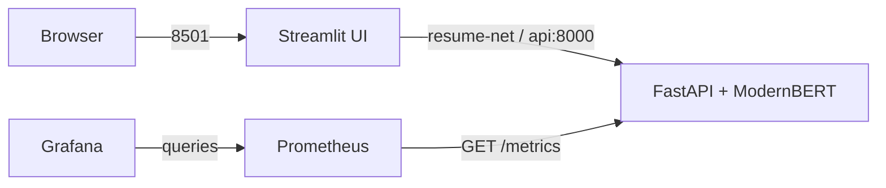

# ResumeClassification

**Author:** [Atharva Gaikwad](https://github.com/atharva315)

ResumeClassification is a resume-to-job-category classifier built with a fine-tuned ModernBERT model. The project covers dataset preparation and model evaluation, an API for inference, a browser interface for resume input, and a containerized AWS deployment with service monitoring.

## Overview

- Fine-tuned ModernBERT model covering 43 job categories.
- Streamlit interface for pasted resume text and PDF, DOCX, TXT, PNG, JPG or JPEG uploads.
- FastAPI service for text prediction, file extraction, health checks and metrics.
- Top predicted category and alternative categories for accepted inputs.
- Docker images built and tested locally, then published to Docker Hub.
- AWS EC2 deployment using separate UI, API, Prometheus and Grafana containers.
- No database or Redis; submitted resume content is not stored in an application database.

## Architecture

The UI sends resume text or uploaded files to FastAPI over the Docker network. The API loads the trained model once and performs inference. Prometheus scrapes the API's `/metrics` endpoint, and Grafana displays service metrics.

## Model development

The training work is recorded in [the model development notebook](notebooks/ResumeClassification_Model_Development.ipynb). It includes dataset checks, exact-duplicate and conflicting-label review, grouped data splits, token-length analysis, BERT baseline evaluation, ModernBERT training/evaluation and packaging the selected checkpoint for inference.

The source dataset was [ResumeAtlas on Hugging Face](https://huggingface.co/datasets/ahmedheakl/resume-atlas).

| Dataset stage | Records |
|---|---:|
| Raw dataset snapshot | 13,389 |
| Prepared dataset after quality checks | 11,864 |
| Training split | 9,473 |
| Validation split | 1,203 |
| Test split | 1,188 |
| Categories | 43 |

The evaluation used the same held-out 1,188-record test split for the BERT baseline and ModernBERT. The models used their configured input limits—512 tokens for BERT and 2,048 tokens for ModernBERT—so this was a comparison of the selected model configurations rather than a same-context-length benchmark.

| Metric | BERT-base | ModernBERT-base |
|---|---:|---:|
| Accuracy | 88.30% | 92.09% |
| Balanced accuracy | 88.16% | 92.60% |
| Macro precision | 87.99% | 92.20% |
| Macro recall | 88.16% | 92.60% |
| Macro F1 | 87.48% | 92.12% |
| Weighted F1 | 88.08% | 92.06% |
| Test loss | 0.5788 | 0.3881 |

These are recorded offline evaluation results, not a guarantee for every resume or live prediction. See [model development notes](docs/model-development.md) for the data-preparation and evaluation context.

## Application components

| Component | Responsibility |
|---|---|
| ModernBERT Base | Fine-tuned 43-category text classifier |
| FastAPI / Uvicorn | Model serving and HTTP API |
| PyTorch / Transformers | Model loading and inference |
| Streamlit / Requests | Resume input and prediction display |
| PyMuPDF / pdfplumber / python-docx | Document text extraction |
| Pillow / Tesseract OCR | Image processing and OCR |
| Docker | Separate application and monitoring containers |
| Docker Hub | Registry for the deployed API and UI images |
| AWS EC2 | Hosts the application on Amazon Linux 2023 |
| Prometheus | Collects API metrics |
| Grafana OSS | Displays availability and API request-rate panels |

## API surface

| Method | Endpoint | Description |
|---|---|---|
| GET | `/` | API information |
| GET | `/health` | Health and model-readiness information |
| GET | `/docs` | FastAPI interactive documentation |
| POST | `/predict` | Classifies text submitted in `prepared_text` |
| POST | `/predict-file` | Extracts and classifies an uploaded resume |
| GET | `/metrics` | Prometheus metrics |

The model was trained on the prepared dataset's `Text_prepared` representation. The inference API now applies the notebook's contact-detail masking rules (`[EMAIL]`, `[URL]`, `[PHONE]`) and collapses whitespace to single spaces before tokenization. It uses a configured maximum input length of 2,048 tokens. File-extraction quality depends on document structure, scan quality and OCR quality.

## Docker Hub images

The application was built and tested with Docker Desktop for Windows. The resulting images were pushed to Docker Hub and pulled by the EC2 host:

- [API — `rockstar1505/resume-classification-api`](https://hub.docker.com/r/rockstar1505/resume-classification-api)
- [UI — `rockstar1505/resumeclassification-ui`](https://hub.docker.com/r/rockstar1505/resumeclassification-ui)

The deployed container images are the tested runtime artifacts. Docker Hub stores these images; the GitHub repository stores application source, configuration, tests and project documentation.

## AWS deployment and monitoring

The application and monitoring stack were deployed and tested on AWS EC2 in the Sydney region (`ap-southeast-2`), using Amazon Linux 2023 and one instance. The instance was subsequently stopped to reduce compute costs, so this repository does not claim that the public demo is currently online.

| Container | Service | Port |
|---|---|---|
| `ui` | Streamlit frontend | Host port 8501 |
| `api` | FastAPI inference | Internal Docker port 8000 |
| `prometheus` | Metrics scraping | Internal port 9090 |
| `grafana` | Monitoring dashboards | Host port 3000, restricted to the administrator's IP |

All four containers were verified running. Prometheus reported the `resume-api` target as `up` with no scrape error. After a test resume prediction, Grafana displayed API availability as `1` and the API request-rate graph showed activity.

The current instance can be stopped between demonstrations. While stopped, the website, API and monitoring dashboards are offline. Attached storage and other associated resources may continue to incur AWS charges.

## Repository layout

- `services/api/` — FastAPI source, Dockerfile, dependencies, regression tests and model manifest.
- `services/frontend/` — Streamlit application and Docker build.
- `notebooks/` — model development notebook, with cell outputs cleared to avoid publishing excerpts of resume text.
- `docs/model-development.md` — dataset preparation and model comparison.
- `docs/dataset-provenance.md` — source snapshot counts and the unpinned revision/checksum limitation.
- `docs/architecture.md` — component and network architecture.
- `docs/repository-guide.md` — description of source, configuration and documentation files.
- `deploy/local/` — local Docker Compose configurations.
- `deploy/ec2/` — record of the completed AWS deployment.
- `monitoring/` — Prometheus configurations and Grafana dashboard notes.

## Model artifacts

The trained `model.safetensors` checkpoint is stored in this public repository using Git LFS, alongside the model configuration, label mapping and tokenizer files. The Git LFS pointer records 598,565,908 bytes and SHA-256 `718f1481c6e7b65a043d373766d77c912aefd78648edf38663d6eb52dbeadd5a`; the upload completed successfully, but the local checksum and model-load verification still need to be run with the included verification script. A fresh clone must have Git LFS installed and fetch the LFS object before building the API image. The Dockerfile copies the local `model/` directory into the image.

## Security and responsible use

The application is a portfolio demonstration and should not be treated as an automated hiring decision system. Classification output can be affected by resume quality, formatting, extraction errors and similarity between job categories. A human should review results before making employment decisions.

The application does not use a database for submitted resumes. The public repository excludes the raw resume dataset, individual test resumes, prediction logs, runtime monitoring data, environment secrets and credentials. The API and Prometheus ports remain internal to the Docker network; Grafana access is limited through the EC2 security group.
