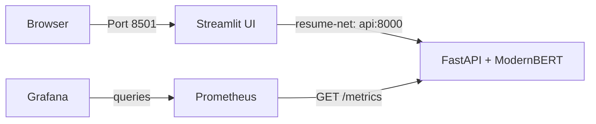

# ResumeClassification

**Author:** [Atharva Gaikwad](https://github.com/atharva315)

ResumeClassification is a resume classification project built around a fine-tuned ModernBERT model. The application separates the user interface from model inference: Streamlit handles resume input, FastAPI serves predictions, and Prometheus/Grafana provide basic service monitoring.

The current application was containerized and deployed to an AWS EC2 instance. Docker Hub stores the API and frontend images used by that deployment. The EC2 instance is stopped when it is not needed for a demo, so the public application and monitoring pages may be offline.

## What it does

- Classifies resume content into 43 job categories.
- Accepts pasted text and PDF, DOCX, TXT, PNG, JPG or JPEG uploads.
- Returns a primary category and alternative predictions for accepted inputs.
- Uses FastAPI for inference and health checks rather than loading the model in Streamlit.
- Exposes Prometheus metrics without placing resume text or filenames in metric labels.
- Runs the UI, API, Prometheus and Grafana as separate Docker containers.
- Does not use a database or Redis to persist submitted resumes.

## Architecture



The current EC2 container names are `ui`, `api`, `prometheus` and `grafana`, connected over Docker network `resume-net`. The UI is exposed on host port 8501. API port 8000 and Prometheus port 9090 should remain private. Restrict Grafana port 3000 to an administrator's current IP.

## Model and evaluation

The model-development notebook records dataset preparation, a BERT baseline, ModernBERT tuning, final held-out evaluation and packaging for inference. See [the notebook](notebooks/ResumeClassification_Model_Development.ipynb) and [model development notes](docs/model-development.md).

The dataset preparation workflow started from the [ResumeAtlas dataset on Hugging Face](https://huggingface.co/datasets/ahmedheakl/resume-atlas) and used text-duplicate and label-conflict checks before creating grouped splits.

| Dataset | Records |
|---|---:|
| Raw source snapshot | 13,389 |
| Final prepared dataset | 11,864 |
| Train | 9,473 |
| Validation | 1,203 |
| Test | 1,188 |
| Categories | 43 |

Recorded results on the same 1,188-row test set:

| Metric | BERT-base | ModernBERT-base |
|---|---:|---:|
| Accuracy | 88.30% | 92.09% |
| Balanced accuracy | 88.16% | 92.60% |
| Macro F1 | 87.48% | 92.12% |
| Weighted F1 | 88.08% | 92.06% |

BERT was evaluated with a 512-token input limit and ModernBERT with a 2,048-token limit. The comparison uses each model's configured context length, so it is not a same-token-limit benchmark. These are recorded offline test results, not a guarantee for every resume or live prediction.

## Technology stack

| Component | Role |
|---|---|
| ModernBERT Base | Fine-tuned 43-category classifier |
| FastAPI and Uvicorn | Inference endpoints, readiness and metrics |
| PyTorch and Transformers | Model loading and inference |
| Streamlit and Requests | Web interface and API client |
| PyMuPDF, pdfplumber, python-docx, Pillow and Tesseract OCR | Text extraction from supported upload formats |
| Docker | Packages the UI, API and monitoring services separately |
| Docker Hub | Stores the published application images |
| AWS EC2 (Amazon Linux 2023) | Hosts the existing containers |
| Prometheus | Collects API metrics from `/metrics` |
| Grafana OSS | Visualizes API availability and request rate |

## API endpoints

| Method | Endpoint | Purpose |
|---|---|---|
| GET | `/` | API information |
| GET | `/health` | Health/model readiness |
| GET | `/docs` | Interactive API documentation |
| POST | `/predict` | Classify text provided in `prepared_text` |
| POST | `/predict-file` | Extract and classify an uploaded resume |
| GET | `/metrics` | Prometheus metrics |

The text model was trained on the prepared dataset's `Text_prepared` representation. The API normalizes incoming text and has a configured maximum input length of 2,048 tokens. The file route performs extraction before classification; extraction quality can vary with scan quality and document formatting.

## Docker Hub images

The images were built and tested locally with Docker Desktop for Windows, then pushed to Docker Hub. The existing EC2 containers pull these Docker Hub images; the ECR repositories created during initial setup are not the registry used by the current running deployment.

The following public images are the ones used by the existing deployment:

- [API — rockstar1505/resume-classification-api](https://hub.docker.com/r/rockstar1505/resume-classification-api)
- [UI — rockstar1505/resumeclassification-ui](https://hub.docker.com/r/rockstar1505/resumeclassification-ui)

The tags currently used are `latest`. Future CI/CD should publish immutable commit-SHA tags as well, so a deployment can be tied to a specific source revision and rolled back if necessary.

## Repository map

- `services/api/` — FastAPI source, Dockerfile, requirements, API tests and model manifest.
- `services/frontend/` — Streamlit application and its Docker build.
- `notebooks/ResumeClassification_Model_Development.ipynb` — dataset preparation, training experiments, evaluation and inference packaging.
- `docs/model-development.md` — data preparation decisions and recorded model comparison.
- `docs/architecture.md` — application and network overview.
- `docs/repository-guide.md` — explanation of the tracked source and configuration files.
- `deploy/local/` — local UI and optional local monitoring Compose files.
- `deploy/ec2/README.md` — notes on the current EC2 runtime and safe updates.
- `monitoring/` — Prometheus scrape configurations for local and EC2 networking, plus Grafana dashboard versioning notes.
- `.github/workflows/README.md` — CI/CD plan and activation checks.

## Running locally

The local Compose file starts the UI and expects the FastAPI service to be running on the Windows host at port 8000:

```powershell
# In services/api, after restoring the model files and installing requirements:
python -m uvicorn app:app --host 127.0.0.1 --port 8000

# From the repository root, in another terminal:
docker compose -f deploy/local/docker-compose.local.yml up -d --build
```

Open `http://localhost:8501`. When finished, stop the local UI with:

```powershell
docker compose -f deploy/local/docker-compose.local.yml down
```

The API Dockerfile expects the complete model folder at `services/api/model/` with `config.json`, `label_mapping.json`, `model.safetensors`, `tokenizer.json` and `tokenizer_config.json`.

## Current source-build limitation

The trained weights file is approximately 570.84 MiB and was not included in the source-audit ZIP supplied for repository preparation. The real weights are therefore **not currently committed in this repository**. The published Docker Hub API image contains the model and is the known working deployment artifact, but a fresh API image cannot be rebuilt from this source checkout until the actual model artifacts are restored.

The root `.gitattributes` is configured to use Git LFS for `.safetensors` files. Git LFS can store a file of this size on GitHub Free, but the account's storage and download quota should be checked before use. See [GitHub's Git LFS limits and billing](https://docs.github.com/en/billing/concepts/product-billing/git-lfs). Do not create placeholder weights or enable API image publishing before a clean build and model startup are verified.

## Deployment and monitoring

The current EC2 deployment uses the already-published Docker Hub images. Prometheus was verified to report the `resume-api` target as `up`, and Grafana showed API availability and request-rate panels after a test prediction.

The current Grafana dashboards have not yet been exported as JSON into this repository. Their live state should not be replaced until the dashboard export and the actual container mount paths are verified. Do not run `docker compose down -v`, delete monitoring volumes, or run the alternative Caddy/DuckDNS Compose configuration from the earlier deployment bundle against the working EC2 instance.

When not demonstrating the project, stop the EC2 instance rather than terminate it. The website and monitoring are offline while the instance is stopped; EBS storage and other associated resources may still incur charges.

## Security and data handling

- Do not commit AWS keys, Docker Hub tokens, private keys, real `.env` files or DuckDNS tokens.
- Do not commit the source dataset, raw resumes, test resumes, per-resume predictions, OCR output or logs containing personal information.
- Keep API port 8000 and Prometheus port 9090 private; restrict Grafana port 3000.
- The public UI is a portfolio demo, not a hardened recruitment product. A human should review any result before a hiring decision.

## Next engineering steps

1. Restore and validate the genuine model artifacts for a clean API build.
2. Export the live Grafana dashboards and check current container mount paths.
3. Add lightweight CI checks for API tests and frontend validation.
4. Build and publish Docker Hub images with commit-SHA tags.
5. Add a manual, least-privilege deployment workflow that updates only `api` and `ui`, preserves monitoring state, and performs health checks before reporting success.

No automated deployment workflow is active yet.
